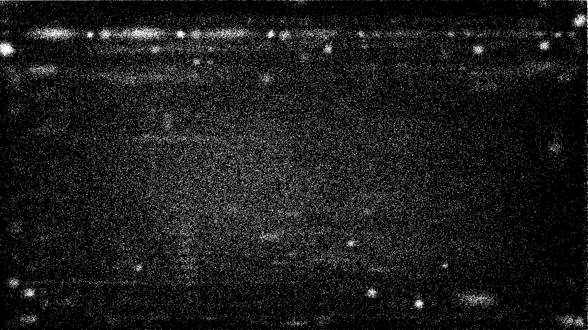
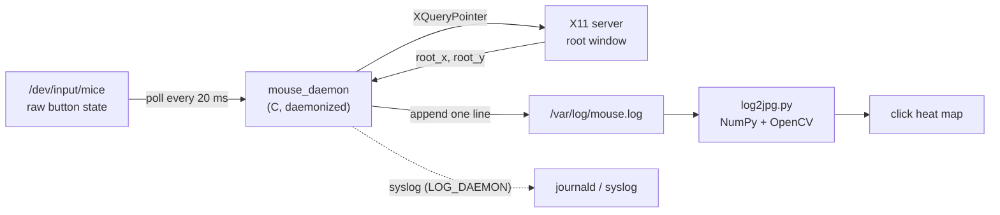
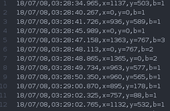
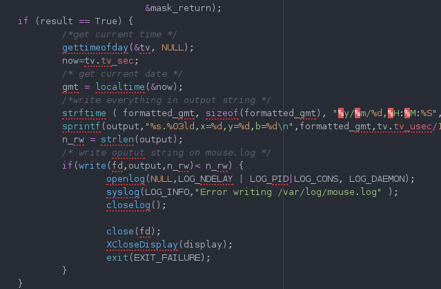

# mouse-daemon

> A lightweight X11 daemon that records every mouse click with its screen coordinates — then turns months of raw click data into a heat map of your screen.


---

## Overview

`mouse-daemon` is a small, dependency-free C daemon that samples the mouse device and, on every button press, resolves the pointer position through X11 and appends a single line to a plain-text log:

```text
18/07/08,03:28:34.965,x=1137,y=503,b=1
```

That is the entire data model: one append-only line per click, no database, no server, no network. The companion script [`log2jpg.py`](log2jpg.py) reads the log, accumulates clicks per pixel, and renders a **grayscale click heat map** where pixel intensity is proportional to how often that pixel was clicked.

The result is a personal, offline usability dataset — a "where do I actually click?" answer, measurable instead of guessed. This repository ships both the capture tool and a real dataset captured over ~4 months of daily use.

<p align="center">
  
</p>

---

## Table of contents

- [Overview](#overview)
- [How it works](#how-it-works)
- [Repository layout](#repository-layout)
- [Requirements](#requirements)
- [Build](#build)
- [Install as a service](#install-as-a-service)
- [Usage](#usage)
- [Log format](#log-format)
- [Generating the heat map](#generating-the-heat-map)
- [Results](#results)
- [Verification](#verification)
- [Design notes and limitations](#design-notes-and-limitations)
- [Roadmap](#roadmap)
- [Contributing](#contributing)
- [License](#license)
- [Author](#author)

---

## How it works



1. **Daemonize** — `fork()`, the parent exits, the child calls `setsid()`, resets `umask(0)`, `chdir("/")` and closes the standard file descriptors.
2. **Open resources** — `/var/log/mouse.log` (append, create if missing) and `/dev/input/mice` (read-only). Failures are reported through `syslog` before exiting.
3. **Poll** — sleep, then issue a blocking read on the mouse device to obtain the current button state.
4. **Debounce** — a `click_considered` flag is raised while a button is held, so one physical press produces exactly one log entry.
5. **Resolve position** — `XQueryPointer()` on the root window returns the absolute pointer coordinates; `gettimeofday()` supplies millisecond-resolution timestamps.
6. **Append** — the event is formatted and written with a single `write()` call, then the loop restarts.

| Component | Language | Lines | Role |
| --- | --- | --- | --- |
| [`mouse_daemon.c`](mouse_daemon.c) | C (POSIX + Xlib) | 197 | Capture daemon |
| [`log2jpg.py`](log2jpg.py) | Python 3 (NumPy, OpenCV) | 30 | Heat map renderer |
| [`mouse.log`](mouse.log) | Plain text | 150,430 events | Reference dataset |
| [`messigray.jpg`](messigray.jpg) | Image | — | Rendered result |

---

## Repository layout

```text
mouse-daemon/
├── mouse_daemon.c     # the daemon: polling, debouncing, X11 lookup, logging
├── log2jpg.py         # log -> per-pixel click counts -> grayscale heat map
├── mouse.log          # 150,430 logged clicks (2018-07-08 → 2018-10-31)
├── messigray.jpg      # heat map rendered from mouse.log
├── thumbnails/        # sample captures used in this document
├── LICENSE.txt        # MIT
└── README.md
```

---

## Requirements

| Dependency | Why |
| --- | --- |
| A Linux distribution with X11 | The daemon reads the mouse device and queries pointer coordinates through Xlib |
| `gcc` (or any C99 compiler) | Builds the daemon |
| `libX11` + development headers | `XQueryPointer`, `XOpenDisplay`, error handler |
| Python 3 with `numpy` and `opencv-python` | Heat map generation only — the daemon itself needs no Python |

Debian / Ubuntu:

```bash
sudo apt-get update
sudo apt-get install build-essential libx11-dev python3-numpy python3-opencv
```

> Developed and validated on Debian GNU/Linux, 64-bit. The capture path relies on the legacy unified `/dev/input/mice` device, which is present on most desktop kernels.

---

## Build

```bash
gcc -O2 -Wall -o mouse_daemon mouse_daemon.c -lX11
```

The build is warning-clean apart from two intentional `-Wunused-parameter` notices in the Xlib error handler, whose signature is fixed by the X library.

---

## Install as a service

The daemon needs read access to `/dev/input/mice` and write access to `/var/log/mouse.log`, so it is normally run as a system service. The binary self-daemonizes (it forks and the parent exits), hence `Type=forking`.

```ini
# /etc/systemd/system/mouse-daemon.service
[Unit]
Description=Mouse click logger (mouse-daemon)
After=display-manager.service

[Service]
Type=forking
ExecStart=/usr/local/bin/mouse_daemon
Restart=on-failure

[Install]
WantedBy=multi-user.target
```

```bash
sudo install -m 0755 mouse_daemon /usr/local/bin/mouse_daemon
sudo touch /var/log/mouse.log && sudo chmod 0644 /var/log/mouse.log
sudo systemctl daemon-reload
sudo systemctl enable --now mouse-daemon
```

<details>
<summary>Legacy alternative: start at login via the shell profile</summary>

The original deployment simply appended the binary to the login shell's profile, which works for a single-user desktop:

```bash
install -m 0755 mouse_daemon /usr/bin/mouse_daemon
echo '/usr/bin/mouse_daemon' >> ~/.profile
```

If the daemon cannot create its log file, pre-create it with the right ownership:

```bash
sudo touch /var/log/mouse.log
sudo chmod 0666 /var/log/mouse.log
```
</details>

---

## Usage

Once started, the daemon runs unattended: it writes one line per click and reports lifecycle events to syslog.

**Confirm it is running.** The daemon logs `started.` after initialising X11:

```bash
systemctl status mouse-daemon          # if installed as a service
journalctl -t mouse_daemon --since today | tail
grep mouse_daemon /var/log/syslog | tail
```

```text
Jul 11 23:45:17 debian mouse_daemon[1155]: started.
```

```bash
ps aux | grep -v grep | grep mouse_daemon
```

**Watch the data stream:**

```bash
tail -f /var/log/mouse.log
```

**Stop it:**

```bash
sudo systemctl stop mouse-daemon
# or, when started from the shell profile
sudo kill "$(pgrep -x mouse_daemon)"
```

---

## Log format

Each line is a self-describing, comma-separated record. Splitting on `,` yields five fields, and each of the last three carries its own key, so the format stays readable with `grep`, `awk`, and `cut`.

| Field | Format | Example | Meaning |
| --- | --- | --- | --- |
| Date | `%y/%m/%d` | `18/07/08` | Local date, two-digit year |
| Time | `%H:%M:%S.mmm` | `03:28:34.965` | Local time with milliseconds |
| X | `x=<px>` | `x=1137` | Absolute root-window X coordinate |
| Y | `y=<px>` | `y=503` | Absolute root-window Y coordinate |
| Button | `b=<n>` | `b=1` | `1` = left, `2` = middle, `3` = right |

Sample:

```text
18/07/08,03:28:34.965,x=1137,y=503,b=1
18/07/08,03:28:40.267,x=0,y=0,b=1
18/07/08,03:28:47.158,x=1363,y=767,b=3
18/07/08,03:28:48.865,x=1365,y=0,b=2
```

<p align="center">
  
</p>

Because the format is line-oriented and append-only, the dataset is trivially consumable from any tool:

```bash
# clicks per day
cut -d, -f1 /var/log/mouse.log | uniq -c

# only right-clicks
grep -c ',b=3$' /var/log/mouse.log
```

---

## Generating the heat map

```bash
python3 log2jpg.py
```

The script reads `mouse.log` from the current directory, counts clicks per pixel, and writes `messigray.jpg`.

**How the intensity is computed.** Only clicks inside the configured frame are counted; a pixel's brightness is its click count normalised by the mean click count per pixel, scaled by 255 and halved:

$$
\text{intensity}(x, y) = \frac{\text{count}(x, y)}{\overline{\text{count}}} \cdot \frac{255}{2}
$$

The mean-relative scaling is what makes the map readable: the average pixel renders as mid-gray, so anything visibly brighter than mid-gray is an area clicked **more often than average**, and dark regions are the ones you rarely touch. All three colour channels receive the same value, which is what gives the render its flat, monochrome look — the origin of the file name *messigray*.

Configuration is done at the top of the script — `w` and `h` must match the resolution of the display that produced the log:

```python
w = 1366
h = 768
```

---

## Results

The bundled [`mouse.log`](mouse.log) contains **150,430 clicks** captured over **115 days** (2018-07-08 → 2018-10-31) of everyday desktop use on a 1366×768 Debian 9 machine.

| Metric | Value |
| --- | --- |
| Logged clicks | 150,430 |
| Capture window | 2018-07-08 → 2018-10-31 (115 days) |
| Left / middle / right clicks | 149,529 / 895 / 6 |
| Clicks inside a 1366×768 frame | 150,192 (99.8 %) |
| Observed coordinate range | x ∈ [0, 2644], y ∈ [0, 1061] |
| Log size | ≈ 5.4 MB (~1.5 MB / month) |

**What the heat map shows.** Three regions dominate, and each maps to a concrete part of the interface:

- **Top-left corner** — the application menu ("start" button), the single brightest cluster on screen.
- **The top band across the width of the screen** — browser tabs and window title bars, clicked constantly while switching context.
- **A few tight clusters in the lower half** — the launcher/dock area and frequently used window controls.

Meanwhile, the large dark expanses in the middle and right of the screen — where reading actually happens — are clicked almost never. The click profile of a desktop is therefore concentrated in a handful of narrow, functional strips rather than spread evenly, which is exactly the kind of insight a click-coordinate dataset can quantify.

<details>
<summary>More captures from the dataset</summary>

| Sample | What it shows |
| --- | --- |
| [`thumbnails/thumbnail1.jpg`](thumbnails/thumbnail1.jpg) | Full-resolution render of the heat map (identical to `messigray.jpg`) |
| [`thumbnails/thumbnail2.png`](thumbnails/thumbnail2.png) | Source excerpt of the logging path, DALTONISM-friendly highlighting |
| [`thumbnails/thumbnail3.png`](thumbnails/thumbnail3.png) | Raw `mouse.log` lines |
</details>

---

## Verification

There is no automated test suite yet — the daemon is validated end to end on a live X11 session:

```bash
# 1. compiles cleanly
gcc -O2 -Wall -Wextra -o mouse_daemon mouse_daemon.c -lX11

# 2. the renderer's input is well-formed: every line has 5 fields
awk -F, 'NF != 5 { bad++ } END { print (bad ? bad " malformed lines" : "all lines well-formed") }' mouse.log

# 3. run the daemon and click a few times, then read the tail
tail -n 5 /var/log/mouse.log

# 4. reproduce the published heat map
python3 log2jpg.py && ls -l messigray.jpg
```

A successful run is characterised by: `started.` in syslog, new lines appended on each click, and one line per physical press (never two).

---

## Design notes and limitations

This is a focused tool, and its constraints are known and deliberate rather than hidden:

- **Polling, not events.** Button state is sampled in a loop instead of subscribing to `XInput2`/evdev events. The header comment documents a 2 ms poll, but the constant evaluates to a 20 ms sleep (`N * 10000000` ns), i.e. a 50 Hz sample rate — sufficient in practice for human clicking, and inexpensive in CPU time, but slower than documented.
- **Single hard-coded frame.** The renderer assumes one 1366×768 screen; coordinates outside it (up to x=2644 in the bundled dataset) are discarded, which is how a 1600×900 window ended up stored in the same file.
- **Fixed paths and format.** Output path, log format and poll interval are compile-time constants.
- **No log rotation or signal handling.** The log grows unboundedly and is closed only through the normal exit paths. Pre-creating it with mode `0666` (as the original instructions did) is broader than necessary; `0644` is enough.
- **Small data artefacts.** Clusters of `x=0,y=0` entries appear when the pointer is parked at the origin (screen off, locked or a display-manager restart) — worth filtering before analysis.
- **Privacy.** This tool records pointer behaviour; treat the log as sensitive personal data and only ever run it on a machine you own and control.

<p align="center">
  
</p>

---

## Roadmap

- [ ] Make output path, poll interval and target resolution configurable (CLI flags + config file)
- [ ] Align the poll interval with the documented 2 ms, or correct the documentation
- [ ] Read the mouse through `XInput2`/evdev directly and drop the legacy `/dev/input/mice` dependency
- [ ] Multi-monitor support with correct per-output geometry
- [ ] `SIGTERM`/`SIGHUP` handling and size-based log rotation
- [ ] `argparse`-driven renderer: histogram equalisation, Gaussian smoothing, PNG/SVG export
- [ ] Automated tests and CI (build + log-format validation)

---

## Contributing

Issues and pull requests are welcome. Please keep changes small and in the spirit of the project: no mandatory runtime dependencies, a readable plain-text log, and a daemon that stays under a few hundred lines of C. Run the checks in [Verification](#verification) before opening a PR and describe which of them you ran.

---

## License

Released under the **MIT License** — see [LICENSE.txt](LICENSE.txt) for the full text.

---

## Author

**Antonio Gaetano "Tony" Barletta**

If you find this project interesting, a ⭐ on the repository is appreciated.
